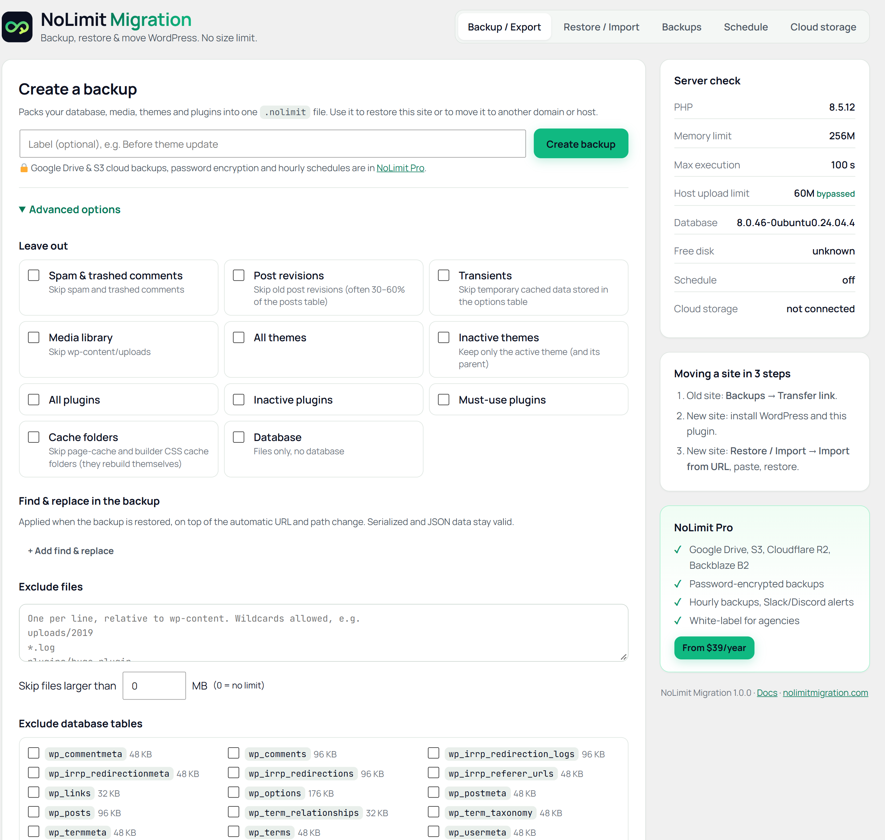
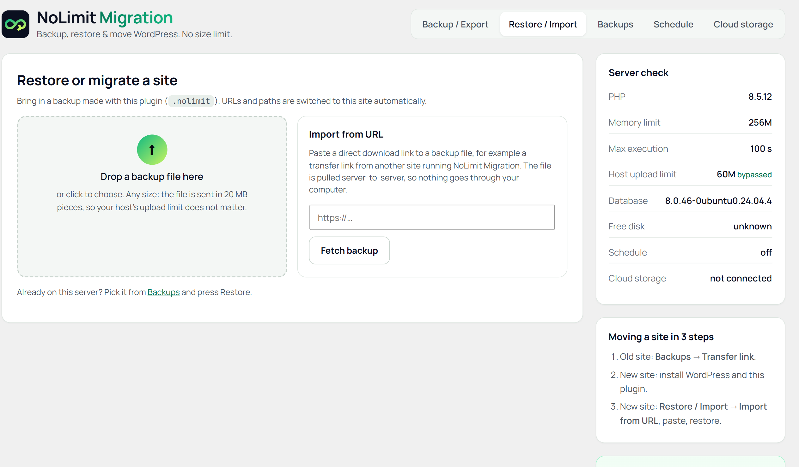
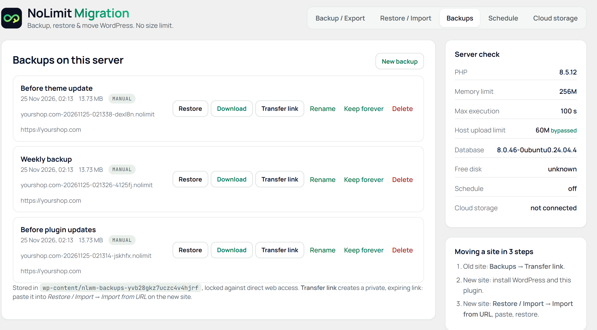
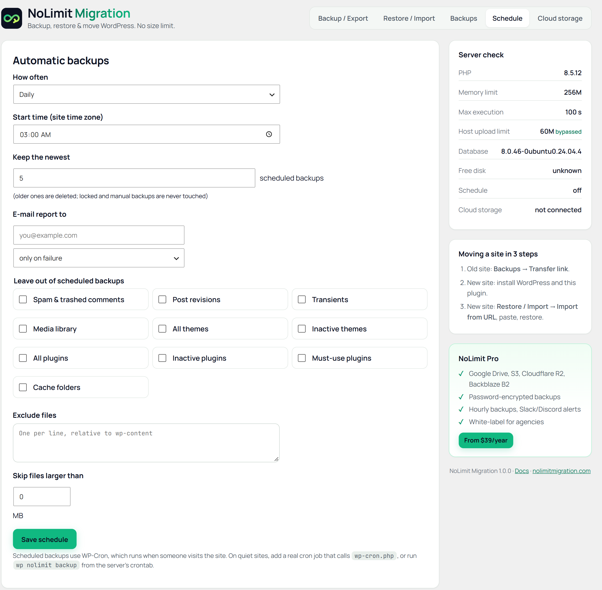

# NoLimit Migration

Back up, restore and move WordPress sites with **no size limit**.

**Install it from WordPress.org:** https://wordpress.org/plugins/nolimit-migration/

## Why it exists

Most backup and migration plugins stop working at the moments you need them most: the site is too big for the free version, the host's upload limit blocks the file, the restore times out halfway, or the URLs and settings break after a move. NoLimit Migration is built around those failures.

## Features

- **No size limit** on backups or restores.
- **Your host's upload limit doesn't matter.** Uploads are sent in 20 MB pieces.
- **Small resumable steps**, so shared hosting with short time limits can finish big jobs.
- **Import from URL.** Paste a transfer link from the old site and the backup is pulled server to server.
- **Automatic URL and path change** on a new domain, safe for serialized and JSON data.
- **Safety backup** before every restore.
- **Find & replace**, file and table exclusions, and a skip list for spam, revisions, transients and caches.
- **Scheduled backups** with retention and e-mail reports.
- **WP-CLI:** `wp nolimit backup`.

## Screenshots

| Create a backup | Restore or migrate |
|---|---|
|  |  |
| **Backups list** | **Scheduled backups** |
|  |  |

## Install

1. In WordPress, go to **Plugins → Add New** and search for **NoLimit Migration**.
2. Install and activate it, then open **NoLimit Migration** in the admin menu.

To use this repository directly, copy it into `wp-content/plugins/nolimit-migration`.

## Requirements

WordPress 5.3+ and PHP 7.2+.

## Feedback

Found a bug or have an idea? [Open an issue](https://github.com/rehmat-labs/nolimit-migration/issues) or use the [support forum](https://wordpress.org/support/plugin/nolimit-migration/). If the plugin saved you time, a [review on WordPress.org](https://wordpress.org/support/plugin/nolimit-migration/reviews/#new-post) helps a lot.

## Author

Built by **Rehmat Ullah**: [WordPress.org](https://profiles.wordpress.org/rehmat727/) · [GitHub](https://github.com/rehmat-labs)

## License

GPLv3 or later. See [LICENSE](LICENSE).
